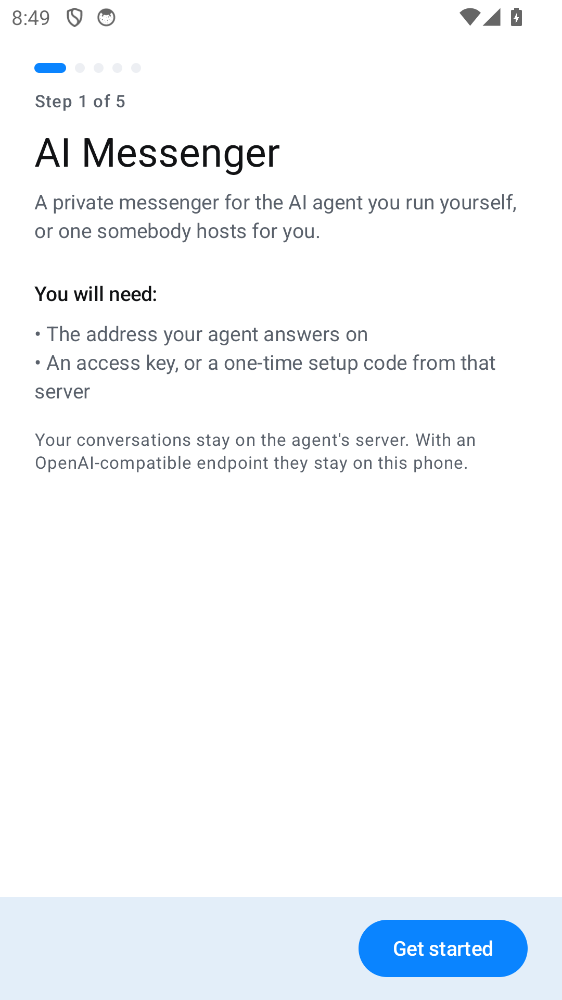
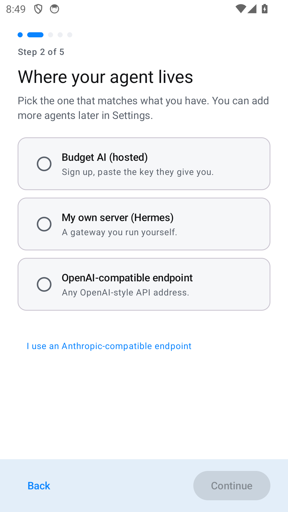
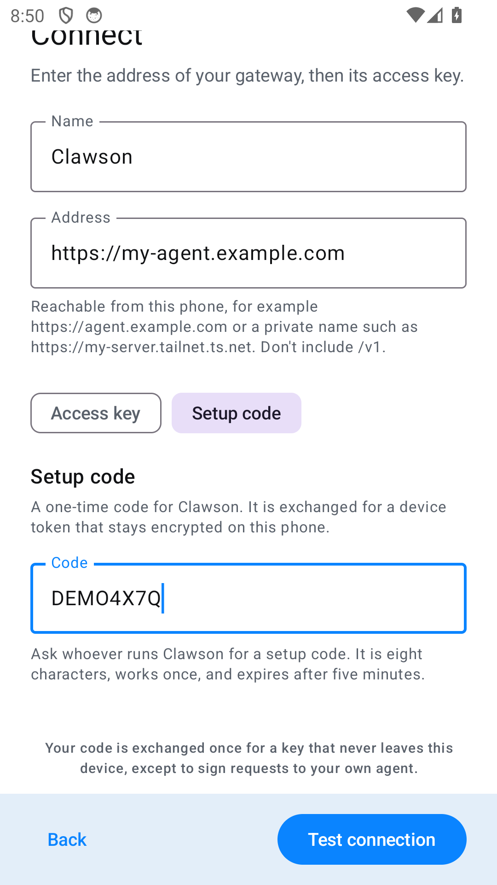
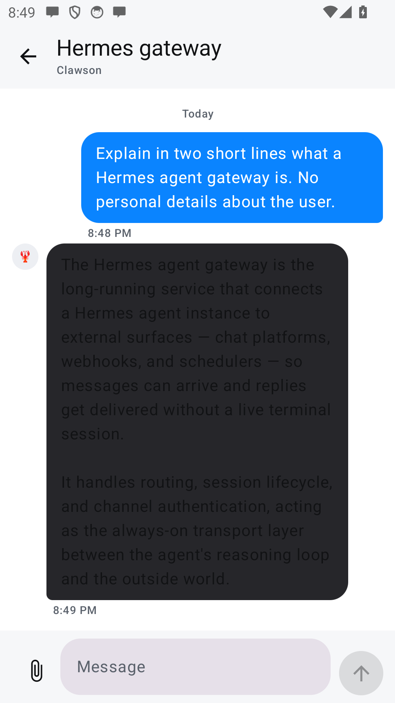

# AI Messenger — release builds

This repository carries **signed APK builds only**. Nothing here is source, and there is nothing to
compile. The source is private and proprietary. If you need a build reviewed for security before
you point it at your own server, say so at [bobbycodes.dev](https://bobbycodes.dev) and you will get
a walkthrough of the network calls and storage.

Download the newest build from the
[Releases](https://github.com/BobbyCodes-dev/ai-messenger-releases/releases) page.

## What it looks like

| First run | Where your agent lives |
|---|---|
|  |  |

| One-time setup code | Chatting |
|---|---|
|  |  |

Five steps from install to first message. Setup takes one of two credentials: an access key, or a
single-use **setup code** minted on your server — in that case the master key never reaches the
phone, only a revocable per-device token does. Names, addresses and the code in these screenshots
are examples.

## Install

1. Open the [latest release](https://github.com/BobbyCodes-dev/ai-messenger-releases/releases/latest)
   and tap the `.apk` asset.
2. Android will ask you to allow installs from this source. Allow it for the
   browser or file manager you used, then tap **Install**.
3. Open **AI Messenger**. The first-run wizard asks where your agent lives and
   how to reach it.

Requires **Android 8.0 (API 26)** or newer.

You need an agent to talk to — your own Hermes gateway, an OpenAI-compatible
endpoint, or a hosted Budget AI account. The app is a client; it ships with no
server of its own.

## Automatic updates (Obtainium)

[Obtainium](https://github.com/ImranR98/Obtainium) watches a GitHub repo and
installs new releases for you, which is the closest thing to store updates
without a store:

1. Install Obtainium.
2. Add app → paste `https://github.com/BobbyCodes-dev/ai-messenger-releases`.
3. Let it check for releases.

Every release is signed with the same key, so updates install over the previous
one without uninstalling. Losing that key would make future updates impossible,
which is why it is backed up and never published.

## Verifying a download

Each release notes the APK's SHA-256. To check before installing:

```bash
sha256sum ai-messenger-<version>.apk
```

## Versioning

`versionCode` increases with every release and `versionName` follows semantic
versioning (`1.0.0`, `1.0.1`, …). Downgrades are rejected by Android, so always
download the newest asset.

## Why not Google Play

Play requires a reviewer to complete setup against a live server, a target-SDK
upgrade cycle, and (for personal accounts) a closed-testing gate. None of that
helps the people who use this app: they run their own agent and can install an
APK. Play remains possible later for the hosted option.

## Reporting problems

Open an issue here with the app version from **Settings → About → Build**, your
Android version, and what you expected to happen. Please don't paste access
keys, setup codes, or conversation contents.
